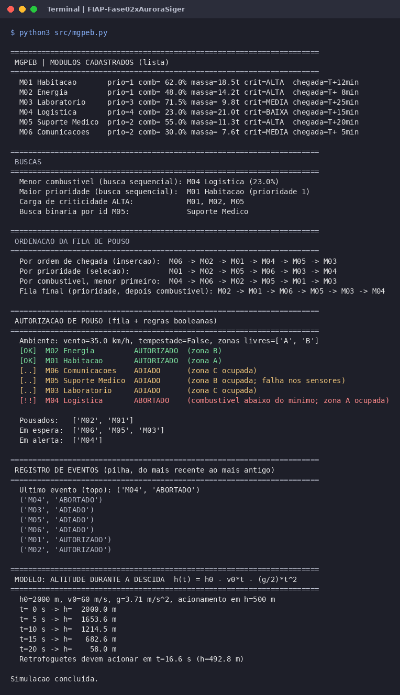
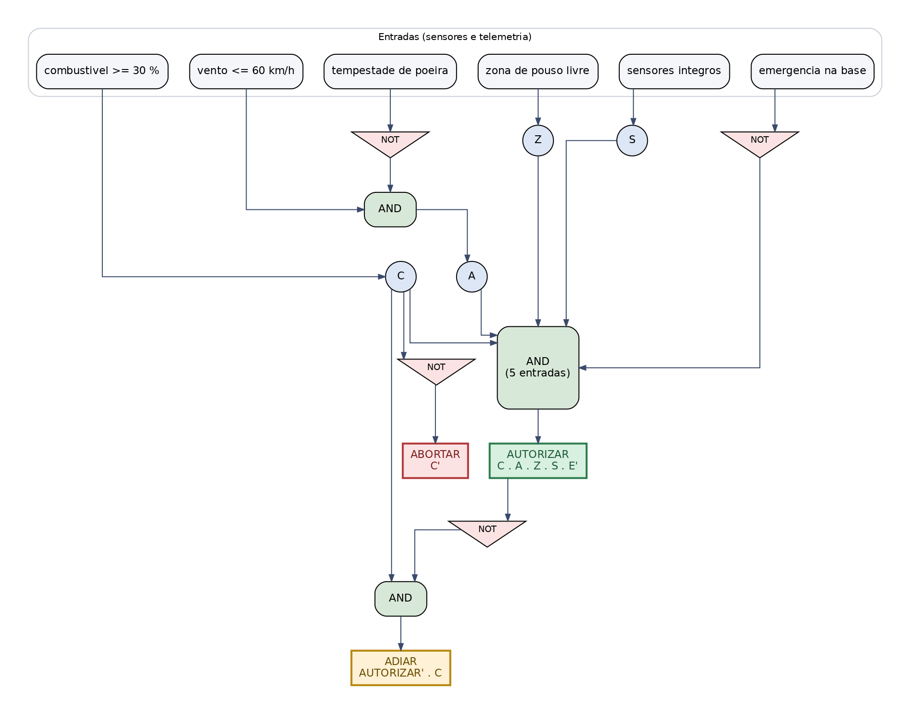
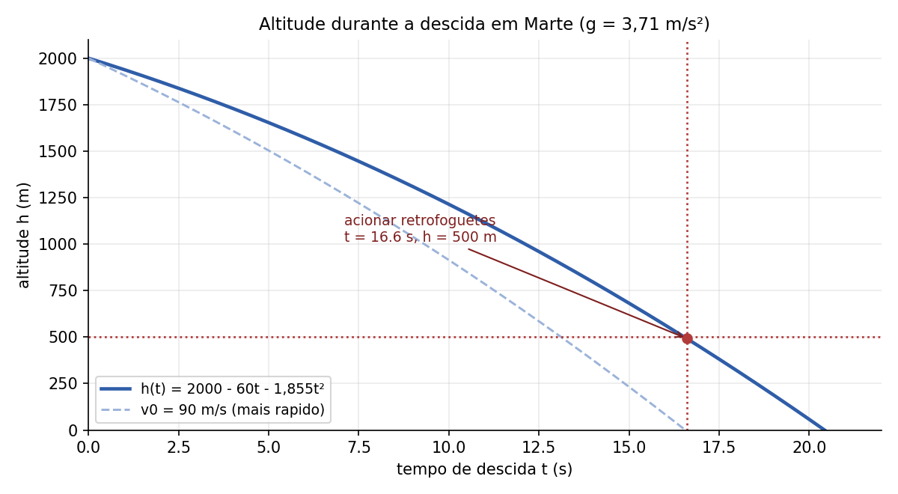

# MGPEB | Módulo de Gerenciamento de Pouso e Estabilização de Base

Atividade Integradora da Fase 2 (FIAP), missão Aurora Siger. **Grupo 3:** Jean Melo.

## Sobre o projeto

A nave Aurora Siger está em órbita de Marte e precisa enviar seis módulos à superfície. O MGPEB é o sistema que organiza a fila de pouso, decide se cada módulo pode descer e registra cada decisão. O protótipo é um único arquivo Python, sem bibliotecas externas, que articula:

- **estruturas lineares:** lista de módulos, fila de pouso (FIFO) e pilha de eventos (LIFO), implementadas à mão;
- **busca:** sequencial (menor combustível, maior prioridade, tipo de carga) e binária (por id);
- **ordenação:** por seleção e por inserção, usadas para montar a fila final (prioridade e, em empate, menor combustível);
- **portas lógicas:** `AUTORIZAR = C AND A AND Z AND S AND NOT E`, com `ADIAR` e `ABORTAR` derivados, espelhadas em `if / elif / else`;
- **modelagem matemática:** altitude durante a descida como função quadrática `h(t) = h0 - v0·t - (g/2)·t²`, usada para calcular o instante de acionar os retrofoguetes.

## Entregáveis

| Arquivo | Conteúdo |
|---|---|
| `docs/relatorio_mgpeb.pdf` | relatório técnico (9 páginas): cenário, portas lógicas, protótipo, modelo matemático, história da computação, ESG e anexo de estruturas de dados |
| `src/mgpeb.py` | protótipo do MGPEB, comentado e executável |
| Anexo A do relatório | uso de listas, filas e pilhas, com exemplos do código |

## Como executar

Requisito: Python 3.8 ou superior. Nenhuma instalação é necessária.

```bash
python3 src/mgpeb.py
```

## Execução



## Circuito de decisão



## Modelo de descida


